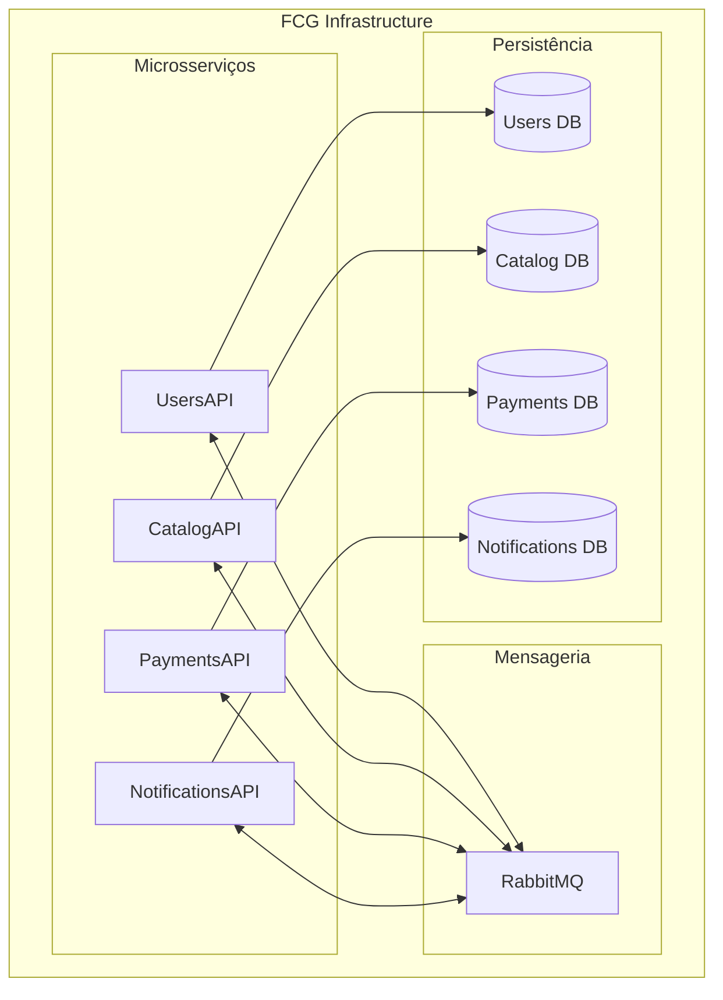

# ☁️ FCG — Infrastructure Repository

Repositório responsável pela infraestrutura e execução integrada dos microsserviços da plataforma **FIAP Cloud Games (FCG)**.

Este projeto centraliza os recursos necessários para executar e integrar os microsserviços da plataforma, incluindo bancos de dados, mensageria, configurações compartilhadas e mecanismos de comunicação entre serviços.

A infraestrutura disponibiliza duas estratégias de execução:

- **Docker Compose:** execução local integrada para desenvolvimento, demonstrações e testes.
- **Kubernetes:** implantação e gerenciamento dos microsserviços em um cluster Kubernetes.

Os microsserviços possuem seus próprios repositórios, responsabilidades, bancos de dados e ciclos de evolução. Este repositório é responsável por disponibilizar o ambiente necessário para que eles funcionem de maneira integrada.

---

## 🏗️ Arquitetura da infraestrutura

A plataforma utiliza uma arquitetura baseada em microsserviços, com comunicação assíncrona através do RabbitMQ e persistência independente por domínio.

### Microsserviços

| Microsserviço | Responsabilidade |
|---|---|
| **UsersAPI** | Gerenciamento de usuários, autenticação e autorização. |
| **CatalogAPI** | Gerenciamento do catálogo, pedidos e biblioteca de jogos. |
| **PaymentsAPI** | Processamento financeiro e gerenciamento dos pagamentos. |
| **NotificationsAPI** | Processamento e envio de notificações. |

### Infraestrutura compartilhada

| Componente | Responsabilidade |
|---|---|
| PostgreSQL | Persistência dos dados, com bancos independentes por microsserviço. |
| RabbitMQ | Comunicação assíncrona e distribuição de eventos. |
| Docker | Containerização dos serviços. |
| Docker Compose | Orquestração do ambiente local. |
| Kubernetes | Orquestração dos containers em cluster. |
| Kustomize | Organização e aplicação dos manifests Kubernetes. |

### Visão geral



Cada microsserviço possui seu próprio banco de dados, evitando compartilhamento de tabelas e dependências diretas entre os domínios.

---

## 📁 Estrutura do repositório

```text
FCG-FIAP-Repo-Infra/
│
├── docker-compose/
│   ├── docker-compose.yml
│   ├── .env
│   ├── init-db/
│   │   └── 01-create-databases.sh
│   └── rabbitmq/
│       └── create-bindings.sh
│
├── k8s/
│   ├── kustomization.yaml
│   │
│   ├── namespace/
│   │   └── namespace.yml
│   │
│   ├── key-vault/
│   │   ├── configmap.yml
│   │   ├── secrets.yml
│   │   ├── set-notifications-secret.ps1
│   │   └── postgres-init-script.yml
│   │
│   ├── postgres/
│   │   └── postgres-deployment.yml
│   │
│   ├── rabbitmq/
│   │   ├── rabbitmq-deployment.yml
│   │   └── rabbitmq-bindings-job.yml
│   │
│   ├── users-api/
│   │   └── users-api-deployment.yml
│   │
│   ├── catalog-api/
│   │   └── catalog-api-deployment.yml
│   │
│   ├── payments-api/
│   │   └── payments-api-deployment.yml
│   │
│   └── notifications-api/
│       └── notifications-api-deployment.yml
│
└── README.md
```

### Organização

- `docker-compose/`: configuração do ambiente local, variáveis, provisionamento dos bancos e bindings do RabbitMQ.
- `k8s/namespace/`: definição do namespace da plataforma.
- `k8s/key-vault/`: configurações compartilhadas, secrets e recursos auxiliares.
- `k8s/postgres/`: Deployment, Service e armazenamento persistente do PostgreSQL.
- `k8s/rabbitmq/`: Deployment, Service e configuração de bindings do RabbitMQ.
- `k8s/*-api/`: Deployment e Service de cada microsserviço.
- `k8s/kustomization.yaml`: centraliza os manifests utilizados pelo Kustomize.

---

# 🐳 Execução local com Docker Compose

## Pré-requisitos

- Docker Desktop instalado e em execução.
- Containers Linux habilitados.
- Docker Compose V2.

Não é necessário clonar os repositórios individuais dos microsserviços nem compilar suas aplicações. As imagens são obtidas diretamente do Docker Hub.

## 1. Clonar o repositório

```bash
git clone https://github.com/FCG-FIAP-Cloud-Games/FCG-FIAP-Repo-Infra.git

cd FCG-FIAP-Repo-Infra
```

## 2. Configurar variáveis de ambiente

Entre na pasta:

```bash
cd docker-compose
```

Configure o arquivo `.env` com as credenciais e parâmetros necessários.

As configurações incluem:

- Credenciais administrativas do PostgreSQL.
- Nome dos bancos e usuários de cada microsserviço.
- Credenciais do RabbitMQ.
- Portas HTTP expostas.
- Tags das imagens Docker.
- Configurações SMTP do NotificationsAPI.

**Importante:** os valores de demonstração não devem ser utilizados em ambientes produtivos. Utilize credenciais próprias e não versione segredos reais.

## 3. Inicializar a infraestrutura

Na pasta `docker-compose`:

```bash
docker compose up -d
```

Verifique os containers:

```bash
docker compose ps -a
```

O Docker Compose inicia:

- UsersAPI
- CatalogAPI
- PaymentsAPI
- NotificationsAPI
- PostgreSQL
- RabbitMQ
- RabbitMQ Bindings

Na primeira inicialização com volumes vazios, os bancos e usuários são provisionados automaticamente. As aplicações responsáveis também preparam suas próprias estruturas de dados.

Não é necessário executar migrations manualmente para o fluxo de demonstração configurado.

## 4. Acessar os serviços

| Serviço | Endereço |
|---|---|
| UsersAPI | http://localhost:5088/swagger |
| CatalogAPI | http://localhost:5081/swagger |
| PaymentsAPI | http://localhost:5082/swagger |
| NotificationsAPI | http://localhost:5083/swagger |
| RabbitMQ Management | http://localhost:15672 |

O acesso ao painel do RabbitMQ utiliza as credenciais configuradas no `.env`.

## 5. Verificar logs

Para consultar os logs dos microsserviços:

```bash
docker compose logs --tail 80 usersapi catalogapi paymentsapi notificationsapi
```

Para acompanhar os logs em tempo real:

```bash
docker compose logs -f
```

## 6. Reiniciar ou parar a infraestrutura

Parar os containers:

```bash
docker compose down
```

Subir novamente:

```bash
docker compose up -d
```

O comando `docker compose down`, sem `-v`, preserva os volumes persistentes.

**Atenção:** evite utilizar `docker compose down -v` em ambientes com dados que precisam ser preservados, pois isso remove os volumes associados ao Compose.

## 7. Atualizar as imagens

Depois de atualizar as tags das imagens no `.env`:

```bash
docker compose pull

docker compose up -d

docker compose ps -a
```

O Docker irá baixar as novas versões e recriar os containers quando necessário.

---

# ☸️ Execução com Kubernetes

A infraestrutura Kubernetes permite executar todas as APIs do projeto em conjunto, utilizando PostgreSQL e RabbitMQ compartilhados.

Toda a configuração está centralizada na pasta `k8s/`, utilizando Kustomize para facilitar a inicialização e gerenciamento dos recursos.

### Pré-requisitos

- Docker Desktop com Kubernetes habilitado ou outro cluster Kubernetes disponível.
- `kubectl` instalado e configurado.
- Acesso ao cluster Kubernetes.

Verifique se o cluster está funcionando:

```bash
kubectl cluster-info
kubectl get nodes
```

### 1. Iniciar toda a infraestrutura

Na raiz do repositório, execute:

```bash
kubectl apply -k ./k8s
```

Esse comando aplica todos os recursos definidos no `kustomization.yaml`, incluindo:

- PostgreSQL;
- RabbitMQ;
- Users API;
- Catalog API;
- Payments API;
- Notifications API;
- ConfigMaps, Secrets e demais configurações necessárias.

Não é necessário executar os manifests individualmente.

### 2. Verificar a inicialização

Consultar todos os recursos do projeto:

```bash
kubectl get all -n fcg-demo
```

Consultar os Pods:

```bash
kubectl get pods -n fcg-demo
```

Acompanhar a inicialização em tempo real:

```bash
kubectl get pods -n fcg-demo -w
```

Consultar os Deployments:

```bash
kubectl get deployments -n fcg-demo
```

Consultar os Services:

```bash
kubectl get services -n fcg-demo
```

Consultar também os volumes persistentes:

```bash
kubectl get pvc -n fcg-demo
```

Aguarde até que os Pods estejam com status `Running` e os containers estejam `Ready`.

### 3. Acessar as APIs e o RabbitMQ

Para acessar os serviços localmente, utilize `kubectl port-forward`.

Abra um terminal separado para cada comando e mantenha os processos em execução.

**Users API**

```bash
kubectl port-forward svc/usersapi 5088:8080 -n fcg-demo
```

Swagger: http://localhost:5088/swagger

**Catalog API**

```bash
kubectl port-forward svc/catalogapi 5081:8080 -n fcg-demo
```

Swagger: http://localhost:5081/swagger

**Payments API**

```bash
kubectl port-forward svc/paymentsapi 5082:8080 -n fcg-demo
```

Swagger: http://localhost:5082/swagger

**Notifications API**

```bash
kubectl port-forward svc/notifications-api 5083:80 -n fcg-demo
```

Swagger: http://localhost:5083/swagger

**RabbitMQ Management**

```bash
kubectl port-forward svc/rabbitmq 15672:15672 -n fcg-demo
```

Painel: http://localhost:15672

Utilize as credenciais definidas no arquivo de Secrets do ambiente local.

### 4. Consultar logs

Para acompanhar os logs de uma API:

```bash
kubectl logs -f deployment/usersapi -n fcg-demo
kubectl logs -f deployment/catalogapi -n fcg-demo
kubectl logs -f deployment/paymentsapi -n fcg-demo
kubectl logs -f deployment/notifications-api -n fcg-demo
```

Logs do RabbitMQ:

```bash
kubectl logs -f deployment/rabbitmq -n fcg-demo
```

Consultar os eventos do namespace:

```bash
kubectl get events -n fcg-demo --sort-by=.lastTimestamp
```

### 5. Reiniciar os serviços

Para reiniciar todos os Deployments:

```bash
kubectl rollout restart deployment -n fcg-demo
```

Acompanhar a atualização:

```bash
kubectl get pods -n fcg-demo -w
```

Para reiniciar apenas uma API:

```bash
kubectl rollout restart deployment/usersapi -n fcg-demo
```

### 6. Atualizar a infraestrutura

Após atualizar as imagens ou configurações dos manifests, execute novamente:

```bash
kubectl apply -k ./k8s
```

O Kubernetes aplicará as alterações necessárias.

### 7. Parar a infraestrutura

Para interromper todos os serviços sem remover os dados persistidos:

```bash
kubectl scale deployment --all --replicas=0 -n fcg-demo
```

Para iniciar novamente:

```bash
kubectl scale deployment --all --replicas=1 -n fcg-demo
```

**Atenção:** para remover completamente os recursos, incluindo os volumes persistentes, utilize:

```bash
kubectl delete -k ./k8s
```

Esse último comando pode excluir os dados do PostgreSQL e as chaves persistidas dos usuários, dependendo da política de retenção do cluster. Utilize somente quando desejar remover completamente o ambiente.

# 🗄️ Persistência e isolamento dos bancos

A infraestrutura utiliza PostgreSQL como servidor relacional compartilhado, mas mantém bancos e usuários separados para cada microsserviço.

| Microsserviço | Banco de dados |
|---|---|
| UsersAPI | Banco exclusivo de Users |
| CatalogAPI | Banco exclusivo de Catalog |
| PaymentsAPI | Banco exclusivo de Payments |
| NotificationsAPI | Banco exclusivo de Notifications |

Essa abordagem mantém o isolamento dos domínios, mesmo quando os serviços utilizam a mesma instância PostgreSQL.

As migrations e alterações de tabelas são responsabilidade dos respectivos microsserviços.

A infraestrutura provisiona os bancos e usuários, mas não deve gerenciar diretamente as estruturas internas das aplicações.

---

# 🔐 Configuração e segurança

As configurações são divididas em dois grupos:

**Configurações não sensíveis:**

- Portas.
- Nomes de bancos.
- Endpoints internos.
- Configurações de ambiente.
- Parâmetros de execução.

**Informações sensíveis:**

- Senhas dos bancos.
- Credenciais do RabbitMQ.
- Credenciais SMTP.
- Chaves privadas e outros segredos de autenticação.

No Docker Compose, as configurações são centralizadas no `.env`.

No Kubernetes, são utilizadas ConfigMaps e Secrets.

Os valores presentes nos arquivos de demonstração devem ser substituídos por credenciais próprias antes de qualquer implantação fora do ambiente local.

---

# 🔗 Repositórios dos microsserviços

Cada aplicação possui seu próprio repositório e documentação.

| Projeto | Repositório |
|---|---|
| UsersAPI | [FCG.UsersAPI](https://github.com/FCG-FIAP-Cloud-Games/FCG.UsersAPI) |
| CatalogAPI | [FCG.CatalogAPI](https://github.com/FCG-FIAP-Cloud-Games/FCG.CatalogAPI) |
| PaymentsAPI | [FCG.PaymentsAPI](https://github.com/FCG-FIAP-Cloud-Games/FCG.PaymentsAPI) |
| NotificationsAPI | [FCG.NotificationsAPI](https://github.com/FCG-FIAP-Cloud-Games/FCG.NotificationsAPI) |

A infraestrutura é responsável pela execução integrada dessas aplicações, enquanto cada repositório mantém suas próprias regras de negócio, implementação e testes.

---

# 🎓 Contexto acadêmico

Projeto desenvolvido como parte do **Tech Challenge da Pós-Graduação em Arquitetura de Sistemas .NET da FIAP**.

O objetivo é demonstrar a aplicação prática de conceitos de arquitetura de microsserviços, containerização, orquestração, comunicação assíncrona, isolamento de dados e infraestrutura distribuída.

---

**FCG Infrastructure — FIAP Cloud Games**

*Infraestrutura centralizada para execução e integração dos microsserviços.*
