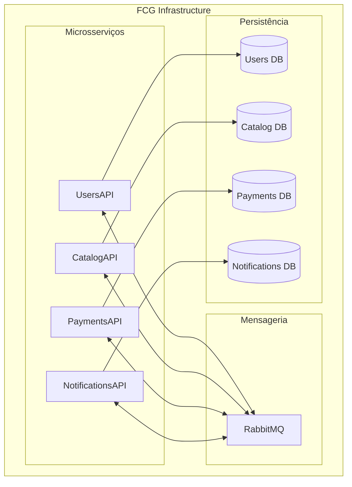

# ☁️ FCG — Infrastructure Repository

Repositório responsável pela infraestrutura e execução integrada dos microsserviços da plataforma **FIAP Cloud Games (FCG)**.

Este projeto centraliza os recursos necessários para executar e integrar os microsserviços da plataforma, incluindo bancos de dados, mensageria, configurações compartilhadas e mecanismos de comunicação entre serviços.

A infraestrutura disponibiliza duas estratégias de execução:

- **Docker Compose:** execução local integrada para desenvolvimento, demonstrações e testes.
- **Kubernetes:** implantação e gerenciamento dos microsserviços em um cluster Kubernetes.

Os microsserviços possuem seus próprios repositórios, responsabilidades, bancos de dados e ciclos de evolução. Este repositório é responsável por disponibilizar o ambiente necessário para que eles funcionem de maneira integrada.

---

## 🏗️ Arquitetura da infraestrutura

A plataforma utiliza uma arquitetura baseada em microsserviços, com comunicação assíncrona através do RabbitMQ e persistência independente por domínio.

### Microsserviços

| Microsserviço | Responsabilidade |
|---|---|
| **UsersAPI** | Gerenciamento de usuários, autenticação e autorização. |
| **CatalogAPI** | Gerenciamento do catálogo, pedidos e biblioteca de jogos. |
| **PaymentsAPI** | Processamento financeiro e gerenciamento dos pagamentos. |
| **NotificationsAPI** | Processamento e envio de notificações. |

### Infraestrutura compartilhada

| Componente | Responsabilidade |
|---|---|
| PostgreSQL | Persistência dos dados, com bancos independentes por microsserviço. |
| RabbitMQ | Comunicação assíncrona e distribuição de eventos. |
| Docker | Containerização dos serviços. |
| Docker Compose | Orquestração do ambiente local. |
| Kubernetes | Orquestração dos containers em cluster. |
| Kustomize | Organização e aplicação dos manifests Kubernetes. |

### Visão geral



Cada microsserviço possui seu próprio banco de dados, evitando compartilhamento de tabelas e dependências diretas entre os domínios.

---

## 📁 Estrutura do repositório

```text
FCG-FIAP-Repo-Infra/
│
├── docker-compose/
│   ├── docker-compose.yml
│   ├── .env
│   ├── init-db/
│   │   └── 01-create-databases.sh
│   └── rabbitmq/
│       └── create-bindings.sh
│
├── k8s/
│   ├── kustomization.yaml
│   │
│   ├── namespace/
│   │   └── namespace.yml
│   │
│   ├── key-vault/
│   │   ├── configmap.yml
│   │   ├── secrets.yml
│   │   ├── set-notifications-secret.ps1
│   │   └── postgres-init-script.yml
│   │
│   ├── postgres/
│   │   └── postgres-deployment.yml
│   │
│   ├── rabbitmq/
│   │   ├── rabbitmq-deployment.yml
│   │   └── rabbitmq-bindings-job.yml
│   │
│   ├── users-api/
│   │   └── users-api-deployment.yml
│   │
│   ├── catalog-api/
│   │   └── catalog-api-deployment.yml
│   │
│   ├── payments-api/
│   │   └── payments-api-deployment.yml
│   │
│   └── notifications-api/
│       └── notifications-api-deployment.yml
│
└── README.md
```

### Organização

- `docker-compose/`: configuração do ambiente local, variáveis, provisionamento dos bancos e bindings do RabbitMQ.
- `k8s/namespace/`: definição do namespace da plataforma.
- `k8s/key-vault/`: configurações compartilhadas, secrets e recursos auxiliares.
- `k8s/postgres/`: Deployment, Service e armazenamento persistente do PostgreSQL.
- `k8s/rabbitmq/`: Deployment, Service e configuração de bindings do RabbitMQ.
- `k8s/*-api/`: Deployment e Service de cada microsserviço.
- `k8s/kustomization.yaml`: centraliza os manifests utilizados pelo Kustomize.

---

# 🐳 Execução local com Docker Compose

## Pré-requisitos

- Docker Desktop instalado e em execução.
- Containers Linux habilitados.
- Docker Compose V2.

Não é necessário clonar os repositórios individuais dos microsserviços nem compilar suas aplicações. As imagens são obtidas diretamente do Docker Hub.

## 1. Clonar o repositório

```bash
git clone https://github.com/FCG-FIAP-Cloud-Games/FCG-FIAP-Repo-Infra.git

cd FCG-FIAP-Repo-Infra
```

## 2. Configurar variáveis de ambiente

Entre na pasta:

```bash
cd docker-compose
```

Configure o arquivo `.env` com as credenciais e parâmetros necessários.

As configurações incluem:

- Credenciais administrativas do PostgreSQL.
- Nome dos bancos e usuários de cada microsserviço.
- Credenciais do RabbitMQ.
- Portas HTTP expostas.
- Tags das imagens Docker.
- Configurações SMTP do NotificationsAPI.

**Importante:** os valores de demonstração não devem ser utilizados em ambientes produtivos. Utilize credenciais próprias e não versione segredos reais.

## 3. Inicializar a infraestrutura

Na pasta `docker-compose`:

```bash
docker compose up -d
```

Verifique os containers:

```bash
docker compose ps -a
```

O Docker Compose inicia:

- UsersAPI
- CatalogAPI
- PaymentsAPI
- NotificationsAPI
- PostgreSQL
- RabbitMQ
- RabbitMQ Bindings

Na primeira inicialização com volumes vazios, os bancos e usuários são provisionados automaticamente. As aplicações responsáveis também preparam suas próprias estruturas de dados.

Não é necessário executar migrations manualmente para o fluxo de demonstração configurado.

## 4. Acessar os serviços

| Serviço | Endereço |
|---|---|
| UsersAPI | http://localhost:5088/swagger |
| CatalogAPI | http://localhost:5081/swagger |
| PaymentsAPI | http://localhost:5082/swagger |
| NotificationsAPI | http://localhost:5083/swagger |
| RabbitMQ Management | http://localhost:15672 |

O acesso ao painel do RabbitMQ utiliza as credenciais configuradas no `.env`.

## 5. Verificar logs

Para consultar os logs dos microsserviços:

```bash
docker compose logs --tail 80 usersapi catalogapi paymentsapi notificationsapi
```

Para acompanhar os logs em tempo real:

```bash
docker compose logs -f
```

## 6. Reiniciar ou parar a infraestrutura

Parar os containers:

```bash
docker compose down
```

Subir novamente:

```bash
docker compose up -d
```

O comando `docker compose down`, sem `-v`, preserva os volumes persistentes.

**Atenção:** evite utilizar `docker compose down -v` em ambientes com dados que precisam ser preservados, pois isso remove os volumes associados ao Compose.

## 7. Atualizar as imagens

Depois de atualizar as tags das imagens no `.env`:

```bash
docker compose pull

docker compose up -d

docker compose ps -a
```

O Docker irá baixar as novas versões e recriar os containers quando necessário.

---

# ☸️ Execução com Kubernetes

O repositório também disponibiliza manifests Kubernetes organizados com Kustomize.

A implantação é centralizada no arquivo:

```text
k8s/kustomization.yaml
```

Esse arquivo reúne os recursos necessários para executar toda a infraestrutura.

## Pré-requisitos

- Kubernetes disponível.
- kubectl instalado.
- Kustomize compatível com a versão do kubectl.
- Cluster com suporte a PersistentVolumeClaim.

## 1. Aplicar os manifests

Os dois Secrets, `fcg-secrets` e `notifications-api-secrets`, são definidos
separadamente em `k8s/key-vault/secrets.yml`, já incluído no Kustomize.
O Secret da NotificationsAPI define `Smtp__User` como `fcgproject.dev@gmail.com`
e reserva `data.Smtp__Password` com o marcador `__SMTP_PASSWORD_REQUIRED__`.
Esse marcador é intencionalmente inválido em base64: a API Kubernetes rejeita
o Secret se ele não for substituído. Não é uma senha de exemplo.

O Kubernetes e o Kustomize não substituem `${SMTP_PASSWORD}` automaticamente.
Por isso, `set-notifications-secret.ps1` continua necessário: executa
`kubectl kustomize`, solicita a senha com entrada oculta, codifica-a em base64
(UTF-8) e substitui o marcador somente em memória. O resultado é enviado pela
entrada padrão do `kubectl`, sem salvar a senha em arquivos ou argumentos.
Base64 é apenas codificação, não criptografia. Não grave nem publique a saída
renderizada com a senha. Nenhuma alteração no `.gitignore` é necessária.

Para o deploy completo, na raiz do repositório, em PowerShell:

```powershell
kubectl config current-context
./k8s/key-vault/set-notifications-secret.ps1 -AllResources
```

Não execute `kubectl apply -k ./k8s/` ou aplique `secrets.yml` diretamente:
isso enviaria o marcador inválido e poderia aplicar outros recursos antes da
falha. Use o script em todos os deploys completos, fornecendo a senha SMTP válida
do ambiente; nunca substitua o marcador no arquivo versionado.

Para corrigir apenas o Secret em um ambiente já implantado (namespace `fcg-demo`
existente), execute sem `-AllResources`; os demais recursos não serão aplicados:

```powershell
./k8s/key-vault/set-notifications-secret.ps1
```

O kubelet tenta iniciar o contêiner novamente quando o Secret fica disponível.
Ao trocar a senha de um contêiner já em execução, reinicie somente esse Deployment:

```powershell
kubectl rollout restart deployment/notifications-api -n fcg-demo
```

Para validar a montagem sem exibir os Secrets ou modificar o cluster:

```powershell
kubectl kustomize ./k8s/ | Out-Null
if ($LASTEXITCODE -ne 0) { throw 'Falha no Kustomize' }
./k8s/key-vault/set-notifications-secret.ps1 -AllResources -DryRun
```

`-DryRun` solicita a senha e usa a validação local do cliente; não comprova
permissões, políticas do servidor nem autenticação SMTP.

Valide a implantação sem exibir valores do Secret:

```powershell
kubectl get secret notifications-api-secrets -n fcg-demo
kubectl rollout status deployment/notifications-api -n fcg-demo --timeout=180s
kubectl get pods -n fcg-demo -l app=notifications-api
```

O resultado esperado é `1/1 Running`, com o rollout concluído. Se falhar, consulte
`kubectl describe pod -n fcg-demo -l app=notifications-api` para verificar os eventos.
O estado Running/Ready não comprova a autenticação SMTP; valide o envio de e-mail
separadamente com as credenciais do ambiente.

O Kustomize aplica os recursos definidos na configuração central, incluindo:

- Namespace.
- ConfigMap.
- Secrets.
- PostgreSQL.
- RabbitMQ.
- RabbitMQ Bindings.
- UsersAPI.
- CatalogAPI.
- PaymentsAPI.
- NotificationsAPI.

## 2. Verificar os recursos

Verificar os pods:

```bash
kubectl get pods -n fcg-demo
```

Verificar os Deployments:

```bash
kubectl get deployments -n fcg-demo
```

Verificar os Services:

```bash
kubectl get services -n fcg-demo
```

Verificar os PersistentVolumeClaims:

```bash
kubectl get pvc -n fcg-demo
```

## 3. Consultar logs

Exemplo para o PaymentsAPI:

```bash
kubectl logs deployment/paymentsapi -n fcg-demo
```

Acompanhar em tempo real:

```bash
kubectl logs -f deployment/paymentsapi -n fcg-demo
```

## 4. Acessar o Swagger do PaymentsAPI

O Service do PaymentsAPI utiliza o tipo `ClusterIP`, portanto não fica diretamente exposto na máquina local.

Para acessar o Swagger através de port-forward:

```bash
kubectl port-forward service/paymentsapi 5082:8080 -n fcg-demo
```

Depois, acesse:

```text
http://localhost:5082/swagger
```

O mesmo procedimento pode ser utilizado para os outros microsserviços, utilizando seus respectivos Services e portas.

## 5. Atualizar a implantação

Depois de atualizar as imagens ou manifests:

```powershell
./k8s/key-vault/set-notifications-secret.ps1 -AllResources
```

Para acompanhar a atualização dos Deployments:

```bash
kubectl rollout status deployment/paymentsapi -n fcg-demo
```

## 6. Remover a infraestrutura

Para remover os recursos gerenciados pelo Kustomize:

```bash
kubectl delete -k ./k8s/
```

A remoção de recursos persistentes deve ser tratada com cuidado, especialmente quando houver dados importantes nos volumes.

---

# 🗄️ Persistência e isolamento dos bancos

A infraestrutura utiliza PostgreSQL como servidor relacional compartilhado, mas mantém bancos e usuários separados para cada microsserviço.

| Microsserviço | Banco de dados |
|---|---|
| UsersAPI | Banco exclusivo de Users |
| CatalogAPI | Banco exclusivo de Catalog |
| PaymentsAPI | Banco exclusivo de Payments |
| NotificationsAPI | Banco exclusivo de Notifications |

Essa abordagem mantém o isolamento dos domínios, mesmo quando os serviços utilizam a mesma instância PostgreSQL.

As migrations e alterações de tabelas são responsabilidade dos respectivos microsserviços.

A infraestrutura provisiona os bancos e usuários, mas não deve gerenciar diretamente as estruturas internas das aplicações.

---

# 🔐 Configuração e segurança

As configurações são divididas em dois grupos:

**Configurações não sensíveis:**

- Portas.
- Nomes de bancos.
- Endpoints internos.
- Configurações de ambiente.
- Parâmetros de execução.

**Informações sensíveis:**

- Senhas dos bancos.
- Credenciais do RabbitMQ.
- Credenciais SMTP.
- Chaves privadas e outros segredos de autenticação.

No Docker Compose, as configurações são centralizadas no `.env`.

No Kubernetes, são utilizadas ConfigMaps e Secrets.

Os valores presentes nos arquivos de demonstração devem ser substituídos por credenciais próprias antes de qualquer implantação fora do ambiente local.

---

# 🔗 Repositórios dos microsserviços

Cada aplicação possui seu próprio repositório e documentação.

| Projeto | Repositório |
|---|---|
| UsersAPI | [FCG.UsersAPI](https://github.com/FCG-FIAP-Cloud-Games/FCG.UsersAPI) |
| CatalogAPI | [FCG.CatalogAPI](https://github.com/FCG-FIAP-Cloud-Games/FCG.CatalogAPI) |
| PaymentsAPI | [FCG.PaymentsAPI](https://github.com/FCG-FIAP-Cloud-Games/FCG.PaymentsAPI) |
| NotificationsAPI | [FCG.NotificationsAPI](https://github.com/FCG-FIAP-Cloud-Games/FCG.NotificationsAPI) |

A infraestrutura é responsável pela execução integrada dessas aplicações, enquanto cada repositório mantém suas próprias regras de negócio, implementação e testes.

---

# 🎓 Contexto acadêmico

Projeto desenvolvido como parte do **Tech Challenge da Pós-Graduação em Arquitetura de Sistemas .NET da FIAP**.

O objetivo é demonstrar a aplicação prática de conceitos de arquitetura de microsserviços, containerização, orquestração, comunicação assíncrona, isolamento de dados e infraestrutura distribuída.

---

**FCG Infrastructure — FIAP Cloud Games**

*Infraestrutura centralizada para execução e integração dos microsserviços.*
